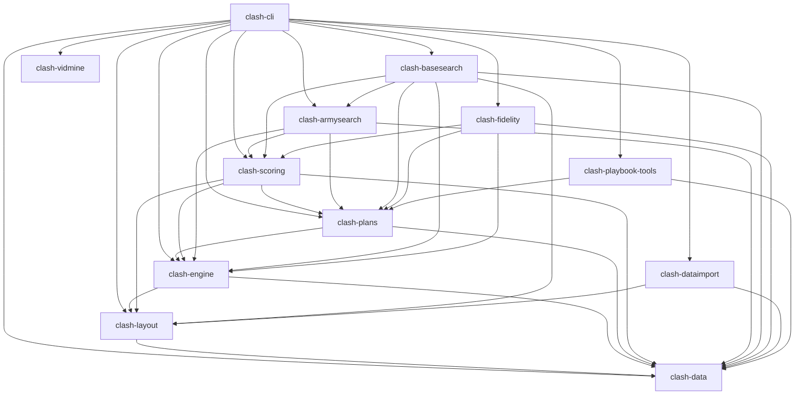
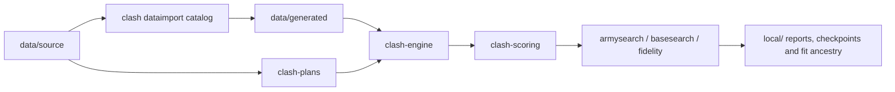

# Workspace architecture

The root workspace builds one supported `clash` CLI and eleven libraries. Rust
is the executable reference. The five reusable libraries are data, layout,
engine, plans and scoring; the other six libraries implement tool workflows.
The crate table in the [root README](../README.md) describes their purposes.
Compatibility binary names forward to the same implementations.

Arrows below mean **depends on** and reflect the workspace manifests, including
the current CLI-owned rule importer. All dependencies are local workspace paths.
There are no external Rust package dependencies.

`clash-engine` depends only on data and layout, including its test dependency
closure. It owns battle state, deterministic math, targeting, movement, combat,
and attacker/playbook execution. It does not import compiler, scoring or tool
code. `clash-plans` owns army composition and compilation/fitting;
`clash-scoring` owns scenario construction, scouting and result scoring.
`clash-vidmine` preserves its independent JSON implementation and has no
workspace dependencies. Provider processes and media utilities belong to tools.
The cited move registry and lossless lowering live in `clash-plans::moves`;
`clash-playbook-tools` hosts their authoring/check CLI. The registry does not
change executor behavior or admit new move compositions.

## Data flow

Arrows here mean **produces or supplies**:

The catalog builder reads the ClashKing snapshot, CSV mechanics, balance overrides,
warden weights, native model declarations and an explicitly available normalized
wiki mirror. It computes the registry and runtime catalog without reading their
previous generated outputs. See [DATA_PIPELINE.md](DATA_PIPELINE.md) for source
precedence, wiki input hashes, number/array equality and legacy CRLF hash rules.

`data/generated/` pins `catalog.json`, `registry.json`, `base_rules.json`,
`clan_castle.json`, `manifest.json` and the declared synthetic `target17.json` /
`target18.json`. Rule import currently uses `clash layout import-rules ROOT OUT`;
the Castle table and search targets remain pinned artifacts with their original
source contracts. Rules retain their original provenance strings as stable
identifiers while the importer reads the relocated source files. The historical
manifest records its original inventory and
hashes; relocation does not claim it is a fresh manifest of the current tree.

`data/source/` contains external snapshots, reviewed model/evidence inputs,
armies, playbooks, calibration priors, reference layouts and relocated legacy
battle logs/accounts. Its `catalog.json` is the upstream video-identity catalog,
not the engine catalog. Licenses live in `data/licenses/`. Wiki acquisition
cache files under `data/source/wiki/` are ignored; the normal verification gate
requires none of them. Existing source/provenance identifiers remain historical.
The [G5a move log](RESTRUCTURE_LOG.md) maps old paths to new paths.

Runtime paths resolve from an explicit root, with catalog precedence:
explicit command/config path → `CLASH_CATALOG` → legacy `BASELAB_CATALOG` →
`ROOT/data/generated/catalog.json`. Low-level `Catalog::load` and `BaseRules::load`
continue to accept explicit paths. Search fingerprints enumerate the relocated
inputs and compiler/playbook files; new identities cannot relabel old fits or
checkpoints. Legacy live inventory overlay behavior is preserved for the frozen
compiler contract; verification's army-search proof explicitly selects its account.
New personal input selection belongs in ignored local/private storage.

An army or playbook compiles to an executable plan. A layout and plan become
worker-local engine battles; the runner preserves job/result order across
threads. Scouting samples its declared hidden ensemble and scoring aggregates
outcomes. Search and fidelity call these reusable APIs; they do not replace the
engine. Video evidence and playbook authoring feed reviewed source inputs through
explicit tool commands; they are not runtime dependencies.

## Regression boundary

`fixtures/` holds declared regression inputs. The three files in
`fixtures/golden/` freeze battle inputs, full traces/outcomes and compiled plans.
Engine executor tests use frozen synthetic prepared plans; compiler tests verify
that they still compile identically. Synthetic checks do not establish real-game
calibration. Unsupported content must continue to fail explicitly.

`scripts/verify.sh` runs formatting, locked offline release build/tests, strict
Clippy and native golden/search/layout/guardian/video checks. It uses temporary
report directories with cleanup and absolute pinned input paths. The gate works
outside the repository working directory. See [GOLDEN.md](GOLDEN.md) and
[RUST_PORT.md](RUST_PORT.md) for the execution contract.

Derived reports, transcripts, extracted evidence, checkpoints and fitted-model
ancestry belong in ignored `local/`. Do not keep downloaded videos or credentials;
use an explicitly selected external video and keyless/local data sources.
